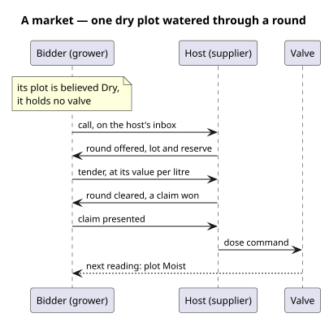

# What it gives the agents

A [market](/domain/market/market.md) is the `market:` domain: a [host](/domain/market/host.md)
holds a venue's good and serves it, and a [bidder](/domain/market/bidder.md) buys a claim on it in
a [round](/domain/market/round.md). Every message is a document one agent says to another, heard by
[speech](/domain/speech/speech.md). Each market role is beneath the planner, the executor, the
speaker and the deliberator, so playing one loads all four.



# What to write

The snippets are from `world/allotment/`: two growers and a supplier, one venue.

**1. The venue**, in `world.ttl`: what it sells, a lot, the least price, and how long bids stay
open.

```turtle
:water a market:Market ;
    market:aboutProperty climate:SoilMoisture ;
    market:lotL 0.5 ; market:reservePerL 1.0 ; market:bidWindowS 30 .
```

**2. Who hosts and who bids**, in `society.ttl`, each agent with an inbox topic it listens on:

```turtle
:supplier a orexis:Agent , mqtt4ssn:Client ;
    market:hosts :water ;
    actuation:hasActuator :rose_valve , :fern_valve ;
    mqtt4ssn:listensToTopic :supplier_inbox .
:fern_grower a orexis:Agent , mqtt4ssn:Client ;
    orexis:actsFor :fern_plot ;
    market:bidsIn :water ; market:valuePerL 2.0 ;
    mqtt4ssn:listensToTopic :fern_grower_inbox .
```

Each inbox is a topic and filter as any other (`agents/supplier/inbox`). The host holds the valves;
a bidder holds none, which is why its plan buys water instead of dosing.

**3. The roles**, in each self graph. A bidder that reads its plot is an
[observer](/runbooks/add-an-observer.md) too, and may be a [predictor](/runbooks/add-a-predictor.md):

```turtle
:supplier a orexis:Self ; orexis:plays [ a market:Host ] .
:fern_grower a orexis:Self ;
    orexis:plays [ a market:Bidder ] ,
                 [ a sensing:Observer ; sensing:sensor :fern_probe ] ,
                 [ a prediction:Predictor ] .
```

**4. The desires**, one document per agent. A bidder wants its plot not believed dry, written as in
[add-a-planner](/runbooks/add-a-planner.md). The host holds two standing desires, each a select
finding what is left undone: no call on a venue it hosts unanswered, and no claim presented to it
unserved (`world/allotment/beliefs/`).

# What onboarding refuses

| refused | because |
|---|---|
| a host that hosts no venue | there is nothing for it to hold |
| a bidder that bids in no venue | there is nowhere for it to bid |
| a speaker that listens to no topic | no peer's document would reach it |
| a topic an agent listens to that no speaker hears | its documents would reach no package |

# Prove it

`world/allotment/tests/test_allotment.py` runs the three agents together and asserts a dry plot is
watered by a claim bought on the supplier's venue, and that one lot goes to the dearer bid.

# What will move

A role is an instance an agent plays, and the market's relations are still stated on the agent:
`market:hosts`, `market:bidsIn` and `market:valuePerL` are to move onto the host and bidder roles,
a venue per role, so one agent can host one venue and bid in another
([a-role-is-an-instance-an-agent-plays](/decisions/a-role-is-an-instance-an-agent-plays.md)).
