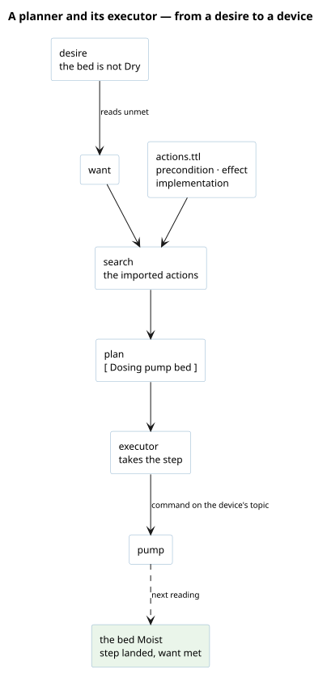

# What it gives the agent

A [planner](/domain/planning/planner.md) derives a want from every desire that reads unmet,
searches the domain's actions for a [plan](/domain/planning/plan.md), and publishes it; the
[executor](/domain/execution/executor.md) walks it, step by step, and holds each step to the
reading that should show its effect. The two are declared together: an executor is refused unless
the agent also plays a planner.



# What to write

The snippets are from `world/greenhouse/`, an agent with devices and a standing desire, and
`world/courier/`, one with a want met once and no bus.

**1. What the agent is for**, a document of its own that says whose it is.

A **desire** is standing: it is weighed every pass, and mints a want each time it reads
unmet ([desire](/domain/planning/desire.md)). Its met-test is a
[shape](/domain/planning/shape.md) the agent's beliefs are held to:

```turtle
<> a planning:DesireGraph ; orexis:ownedBy :grower .
:grower planning:holds :the_bed_is_comfortable .
:the_bed_is_comfortable a planning:Desire ;
    planning:metWhen :comfortable .
:comfortable a sh:NodeShape ;
    sh:targetNode :grower ;
    sh:property [ sh:path orexis:actsFor ;
        planning:about climate:SoilMoisture ;
        sh:qualifiedMaxCount 0 ;
        sh:qualifiedValueShape [ sh:property [ sh:path climate:soil ; sh:hasValue climate:Dry ] ] ;
        sh:message "the bed's soil is believed dry" ] .
```

Read it as "no subject the grower acts for is believed dry". A desire about an unwanted thing that
exists, as a host's unanswered call, is easier said by `planning:unmetWhen` with a select that
finds it.

A **want** is met once, and an agent holding only wants, reached by no transport, stops when every
one is reached:

```turtle
<> a planning:WantGraph ; orexis:ownedBy :courier .
:courier planning:holds :every_parcel_delivered .
:every_parcel_delivered a planning:Want ;
    planning:metWhen courier:delivered ;
    planning:estimates courier:drivesOwed .
```

`planning:estimates` is optional: a select that never overstates the cost left, which turns the
search from uniform-cost into A\*.

**2. The actions**, imported with their domain. `actuation:` ships Dosing and `climate:` Heating;
each says what it takes, when it is possible, what it changes and how it is done
([action](/domain/kernel/action.md)). A new way of acting is a node in a domain's `actions.ttl`
([add-a-domain](/runbooks/add-a-domain.md)), never code.

**3. The devices**, for an agent that commands one. The world says what the device is and does,
and the society says the agent holds it and which topic it takes commands on:

```turtle
# world.ttl
:pump a actuation:Valve ;
    actuation:actuates :bed ; actuation:actuatesProperty climate:SoilMoisture ;
    actuation:drawsFrom :water_butt ; actuation:mlPerSecond 10.0 ; actuation:maxDoseMl 500.0 .
# society.ttl
:grower actuation:hasActuator :pump , :heater .
:pump mqtt4ssn:listensToTopic :pump_commands .
```

Dosing is possible only where the agent holds a valve that actuates a subject it acts for, and that
subject's soil is believed dry: the belief comes from an [observer](/runbooks/add-an-observer.md).

**4. Where things stand, for a world nothing senses**, a `state.ttl` of the agent's own
(`orexis:BeliefGraph`), as the courier's van and parcel.

**5. Constraints, if two plans could collide**, a `planning:ConstraintGraph` holding a
`planning:Constraint` whose `planning:unmetWhen` finds the impossible world: two vans at one position,
the courier's in `domains/courier/constraints.ttl`, held by `world/lane/constraints.ttl` ([constraint](/domain/planning/constraint.md)).

**6. The roles, and the budget**, in the self graph. A search needing more than planning's 32
candidates a pass states its own [budget](/domain/planning/budget.md), measured by the world's test:

```turtle
:courier a orexis:Self ;
    orexis:plays [ a planning:Planner ] , [ a execution:Executor ] .
:courier planning:budget 128 .
```

# What onboarding refuses

| refused | because |
|---|---|
| a planner holding no desire and no want | it would plan nothing |
| a desire or a want carrying both `metWhen` and `unmetWhen`, or neither | it would be judged by nothing |
| an executor that is no planner | nothing would publish a plan for it to walk |
| a present that violates a constraint | an impossible world is not repaired |

# Prove it

Run the world to the claim it was written for. The greenhouse's test delivers a dry reading and
asserts the pump command; the courier's runs until the want is met and the agent stops:

```python
runtime.deliver("sensors/bed_board/reading", b'{"moisture": 0.2}', NOW)
runtime.run(passes=1, poll_s=0)
assert broker.published == [("actuators/pump/command", {"dose_ml": 500}, False)]
```

Hand the test no budget: it then searches at the one the self graph states, as the container will.

# After birth

A desire, a want, a role or a budget is the agent's own and reaches a running agent only on a fresh
belief volume. A device's rate, a cap or a range is the world's, read again on a restart
([run-a-world](/runbooks/run-a-world.md)).
