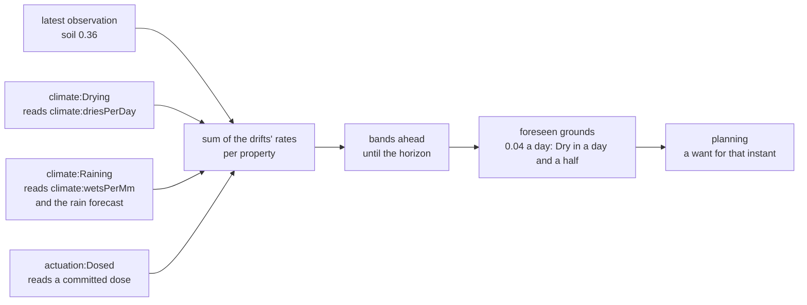

# What it gives the agent

A [predictor](/domain/prediction/predictor.md) answers each observation with where the reading is
heading, as bands ([prediction](/domain/prediction/prediction.md),
[corridor](/domain/prediction/corridor.md)). Planning then sees the bed go dry tomorrow, not only
that it is dry now, so a want can be minted before the crossing.



# What to write

**1. The role**, beside the observer's in the self graph. A predictor needs a sensor reporting
to the agent, and onboarding refuses a sensor no observer role reads, so in practice it plays an
[observer](/runbooks/add-an-observer.md) too.

```turtle
:grower a orexis:Self ;
    orexis:plays [ a sensing:Observer ; sensing:sensor :moisture_probe ] ,
                 [ a prediction:Predictor ] .
```

**2. The drifts**, from a domain: a `prediction:Drift` says which property it moves and gives a
rate, read off facts the world states. Importing the domain's ontology brings its `drifts.ttl`.

| drift | moves | reads on the subject |
|---|---|---|
| `climate:Drying` | soil moisture | `climate:driesPerDay` |
| `climate:Raining` | soil moisture | `climate:wetsPerMm`, and a precipitation forecast on its place |
| `actuation:Dosed` | soil moisture | a dose the agent has committed to |

**3. The facts the drifts read**, on the subject in `world.ttl`:

```turtle
:bed climate:driesPerDay 0.04 ; climate:wetsPerMm 0.01 ; schema:containedInPlace :terrace .
```

**4. How far ahead**, if not a day: `prediction:horizonS` on the self, a
[stance](/domain/kernel/stance.md). A crossing past the horizon is not foreseen yet.

# What onboarding refuses

A predictor with no sensor of its own, or a world stating no drift: it would foresee nothing.

# Prove it

`world/greenhouse/tests/test_greenhouse.py` asserts that a committed dose shows in the bed's
prediction; a world of your own asserts the instant its subject is foreseen to cross.
