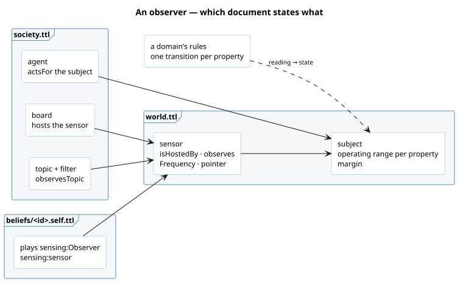
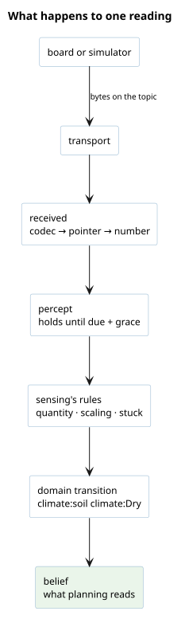

# What it gives the agent

An [observer](/domain/sensing/observer.md) turns what its sensors report into percepts, and a
domain's [transition](/domain/belief/transition.md) turns the latest percept into a belief about
the subject: the bed is dry. Playing the role loads [sensing](/domain/sensing/sensing.md), belief
(an observer is a [deliberator](/domain/belief/deliberator.md)), and the
[transport](/domain/transport/transport.md) its sensors are reached by.



What happens to one reading once the agent runs:



# What to write

The snippets are from `world/greenhouse/`, the smallest world that closes the loop, and
`world/terrace/`, the one with a real board, several sensors on one message and a forecast.

**1. The subject and its ranges**, in `world.ttl`. A range per property the agent cares about,
with a [margin](/domain/sensing/margin.md) sized from the instrument's noise so a reading
hovering at a bound does not flip the state every cadence ([region](/domain/sensing/region.md)).

```turtle
:bed a sosa:FeatureOfInterest ;
    ssn-system:hasOperatingRange :bed_operating .
:bed_operating a ssn-system:OperatingRange ;
    ssn-system:inCondition [ a ssn-system:Condition , schema:PropertyValue ;
        ssn:forProperty climate:SoilMoisture ;
        schema:minValue 0.30 ; schema:maxValue 0.60 ; sensing:margin 0.0002 ;
        schema:unitCode unit:UNITLESS ] .
```

**2. The sensor**, in `world.ttl`: what it is mounted in, what it observes and how often it
reports. It reports to an agent acting for its host, for a sample of it (`sosa:isSampleOf`), or for
a place containing it (`schema:containedInPlace`).

```turtle
:moisture_probe a sosa:Sensor ;
    sosa:isHostedBy :bed ;
    sosa:observes climate:SoilMoisture ;
    ssn-system:hasSystemCapability [ ssn-system:hasSystemProperty
        [ a ssn-system:Frequency , schema:PropertyValue ; schema:value 10 ; schema:unitCode unit:MIN ] ] .
```

| optional | when |
|---|---|
| no frequency | the sensor has no cadence: its reading never goes missing, and it is never silent or stuck |
| `sensing:readingPointer "/moisture_raw"` | the board publishes several values in one message; the default is `/value` |
| `sensing:TwoPointScaling`, `sensing:TwoPointCalibration` | the board sends raw counts, or reads a little off ([scaling](/domain/sensing/scaling.md), [calibration](/domain/sensing/calibration.md), [calibrate-a-probe](/runbooks/calibrate-a-probe.md)) |
| `sensing:endsPointer`, `sensing:startsPointer` | the sensor reads a series, as a weather service's forecast ([forecast](/domain/sensing/forecast.md)) |

**3. Who acts for it, and how its bytes arrive**, in `society.ttl` (in `world.ttl` for a world
with no bus). The agent `orexis:actsFor` the subject; a board hosts the sensor; the sensor observes the
board's topic. Its name is nobody's to state: `orexis-onboard` derives `sensors/bed_board/reading`
into `society.derived.ttl` ([requirement](/domain/onboarding/requirement.md)), and a second sensor on
the board observes the same topic, reading its own value of the board's one message by
`sensing:readingPointer`.

```turtle
:grower a orexis:Agent , mqtt4ssn:Client ; orexis:actsFor :bed .
:bed_board a mqtt4ssn:Client ; mqtt4ssn:hasClientID "bed_board" ; mqtt4ssn:hosts :moisture_probe .
:bed_readings a mqtt4ssn:Topic .
:moisture_probe mqtt4ssn:observesTopic :bed_readings .
```

Several sensors may observe one topic and differ only by their pointer, as the terrace's five do.
A sensor fetched over HTTP is a `td:Thing` with a `td:hasForm` whose `hctl:hasTarget` is the URL; a
`{latitude}` in it is filled from the place's `schema:geo`, kept in the world's `secrets/`, out of
git.

**4. The role**, in the agent's self graph: every sensor it reads, and its limits if it wants
other than the defaults (silent after 3 cadences, stuck after 6 equal readings).

```turtle
:grower a orexis:Self ;
    orexis:plays [ a sensing:Observer ;
                   sensing:sensor :moisture_probe , :thermometer ;
                   sensing:silentAfter 3 ] .
```

A sensor judged by other limits goes in a second observer role.

**5. A domain whose transition makes a state of the reading.** Without one the agent keeps the
percepts and believes nothing of the subject. `climate:` ships one for soil moisture and one for
air temperature (`domains/climate/rules.ttl`), imported with its ontology:

```turtle
<> a orexis:WorldGraph ; owl:imports <../../domains/climate/ontology.ttl> .
```

A property no domain has a transition for is [add-a-domain](/runbooks/add-a-domain.md).

**6. Something behind it.** A real board is its `hardware.ttl` and `orexis-firmware <name>`. A
simulated one is a model on the system, and the world imports `domains/sim/ontology.ttl`:

```turtle
:moisture_probe sim:simulatedBy [ a sim:Model ;
    sim:initialValue 0.31 ; sim:minValue 0.0 ; sim:maxValue 1.0 ; sim:jitter 0.01 ] .
```

Give it jitter at least the instrument's noise: a simulated number that never moves reads as a
stuck sensor ([stuck](/domain/sensing/stuck.md)).

# What onboarding refuses

| refused | because |
|---|---|
| an observer role naming no sensor | it would observe nothing |
| a role naming a sensor mounted on nothing the agent acts for | the sensor does not report to it |
| a sensor mounted on what the agent acts for that no role names | its bytes would reach no package |
| a sensor observing no property, or mounted on nothing | it reports nothing of anything |
| a range's condition with no one property, or a floor not below its ceiling | no reading can be judged by it |
| a margin that is no number, negative, or half the range or more | the state could never be left |

# Prove it

A test beside the world delivers a message on the sensor's topic and asserts the belief, as
`world/greenhouse/tests/test_greenhouse.py` does:

```python
runtime.deliver("sensors/bed_board/reading", b'{"moisture": 0.2}', NOW)
runtime.drain(NOW)
assert _held(runtime.beliefs) == {("soil", "Dry")}
```

# After birth

A sensor added to a running agent's role, or a limit changed, reaches it only on a fresh belief
volume: the self graph is the agent's own, and a lived-in volume keeps the one it was born with
([run-a-world](/runbooks/run-a-world.md)). A range, a margin, a scaling or a frequency is the
world's, read again on a restart.
