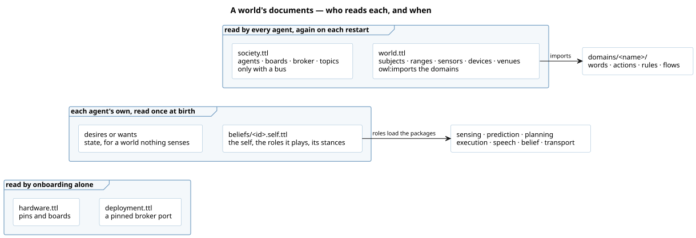

# The shape of it

# Which roles, and what each asks

A role is what an agent runs: playing it loads its packages, and each role's shape says what the
world must state for it ([role](/domain/kernel/role.md)). Pick the roles first; each runbook says
what to write for one.

| role | loads | the world must state | how |
|---|---|---|---|
| `sensing:Observer` | sensing, belief, the transport its sensors need | a sensor reporting to the agent, named by the role | [add-an-observer](/runbooks/add-an-observer.md) |
| `prediction:Predictor` | prediction | a sensor of the agent's and a drift | [add-a-predictor](/runbooks/add-a-predictor.md) |
| `planning:Planner` with `execution:Executor` | planning, execution | a desire or a want; the actions and devices it acts with | [add-a-planner](/runbooks/add-a-planner.md) |
| `market:Host`, `market:Bidder` | planning, execution, speech, belief, the MQTT transport | a venue it hosts or bids in, and an inbox topic | [add-a-market](/runbooks/add-a-market.md) |
| `speech:Speaker` | speech, the MQTT transport | a topic the agent listens to; a domain's extraction for what it hears | [speaker](/domain/speech/speaker.md) |
| `belief:Deliberator` | belief | nothing; it runs the rules its domains ship | [deliberator](/domain/belief/deliberator.md) |

# What to write

A directory `world/<name>/`, and in it documents that each say which graph they are
([world](/domain/kernel/world.md)):

1. **`world.ttl`** — `<> a orexis:WorldGraph ; owl:imports <../../domains/…/ontology.ttl>`, then
   the subjects, their [regions](/domain/sensing/region.md), the sensors, devices and systems, and
   the venues. It speaks no MQTT4SSN. In a world with no bus, the one agent goes here too.
2. **`society.ttl`**, for a world with a bus — `<> a orexis:SocietyGraph`, then the agents
   (`a orexis:Agent , mqtt4ssn:Client ; orexis:localId "…" ; orexis:actsFor …`) with the devices
   each `actuation:hasActuator` and the venues each hosts or bids in, the boards as clients and
   what each `mqtt4ssn:hosts`, the one `mqtt4ssn:Broker` every client `mqtt4ssn:isConnectedToBroker`,
   and the topics, their filters, and which sensor `mqtt4ssn:observesTopic` and which device
   `mqtt4ssn:listensToTopic` each one.
3. **`deployment.ttl`, only to pin the broker's port** — `<> a onboarding:DeploymentGraph`, then
   the broker's `schema:url`s, `mqtt://` and `mqtts://`, one host. Leave it out and `orexis-onboard`
   allocates the broker a port free of every other world's, into `infra/installation.derived.ttl`;
   write it when something is flashed with the port, as the terrace's board is. A port another
   world holds is refused. Onboarding reads either to run the broker and to write each agent's
   environment; no agent loads them and no container mounts them.
4. **who each agent is, and what it runs** — `beliefs/<id>.self.ttl`, `<> a orexis:SelfGraph` and
   the one row stating the self and the ROLES it plays, `:fern_grower a orexis:Self ; orexis:plays [ a
   market:Bidder ] , [ a sensing:Observer ; sensing:sensor :fern_probe ] , [ a prediction:Predictor ]`,
   for every agent the world states: an agent whose world
   authored none, or two, refuses to boot, and the boot checks this one against the id it is told
   ([self](/domain/kernel/self.md)). The roles are what the agent runs, and nothing loads without
   one ([role](/domain/kernel/role.md)): in a domain's words where the domain has them — the market's
   `market:Host` and `market:Bidder` — and otherwise in the packages' own: `planning:Planner` and
   `execution:Executor` for an agent with a desire or a want to plan and walk, `sensing:Observer` for
   one a sensor reports to — naming each sensor it reads, `sensing:sensor`, and any `sensing:silentAfter`
   or `sensing:stuckAfter` it holds them to ([observer](/domain/sensing/observer.md)) —
   `prediction:Predictor` for one that foresees by a drift,
   `speech:Speaker` for one that hears on a topic, `belief:Deliberator` for one holding rules (an
   observer and a market role are one already). `orexis-onboard` refuses an agent playing none, a
   role whose needs the world lacks, a sensor reporting to no observer role, a sensor a role reads that
   reports to the agent from nowhere, and a topic no speaker hears.
   Beside that row, any figure the agent holds of itself — its patience, a budget, its horizon — as a
   triple about the self; stated in any other document it is not read
   ([stance](/domain/kernel/stance.md)). **A planner whose search needs more than planning's 32
   candidates a pass states the budget it needs**, `:courier planning:budget 128`, at the figure the
   world's own test measured — and that test hands the Planner and the Runtime no budget of its own,
   so it reads the stated one and fails if it is too low; a test handing its own proves a figure no
   container searches at. Neither reaches a volume already lived in: a role or a stance changed after
   birth needs a fresh volume.
5. **`state.ttl`** — `<> a orexis:BeliefGraph`, where things stand, for a world nothing senses.
6. **what each agent is for** — `<> a planning:DesireGraph` for standing desires, or
   `<> a planning:WantGraph` for a want that is met once; in a world of several agents, one
   document per agent under `beliefs/<id>.ttl`, since every desire a store holds is derived for.
   Every document of a kind that is an agent's own — the state, the desires, the wants — says whose
   beside its kind, `<> orexis:ownedBy :fern_grower`; the file's name says nothing to any reader.
7. **`hardware.ttl`** — `<> a onboarding:HardwareGraph`, pins and boards, if there are any: read
   by `orexis-firmware`, and a kind no agent declares, so a boot passes over it and no container
   mounts it. A document of a kind no reader declares is refused by `orexis-onboard`.

State ranges, values and lots — picks. Never state a step, a dose or a price paid: those are
the agents' to find.

# Prove it

`world/<name>/tests/test_<name>.py` boots it — `Runtime(boot(WORLD, "<id>"), "<id>")` with a clock
that ticks — runs it and asserts what it was written for: the tower stands, the fern was served.
Run it with `pytest world/<name>`. A world the loader refuses fails here first, with the document
and the reason.

# Run it

To run it in containers, [onboarding](/domain/onboarding/onboarding.md) grants the credentials and
writes the compose file: `orexis-onboard <name>`, then [run-a-world](/runbooks/run-a-world.md). A
world with no bus is onboarded too — its compose file is its agents and nothing of a broker.
